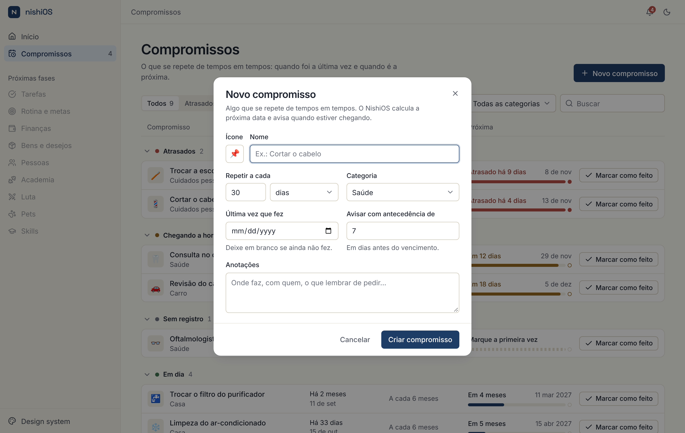
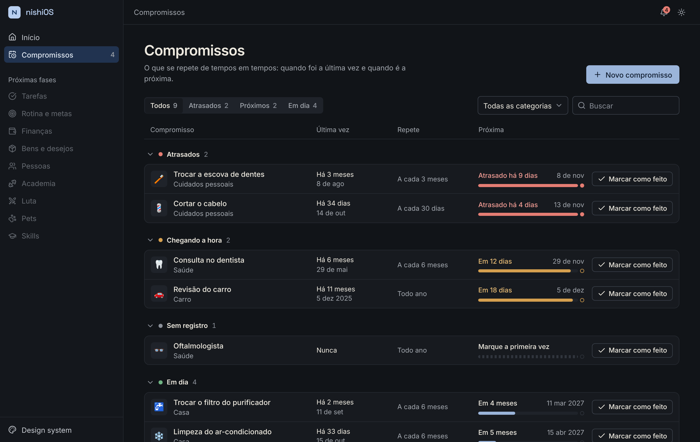
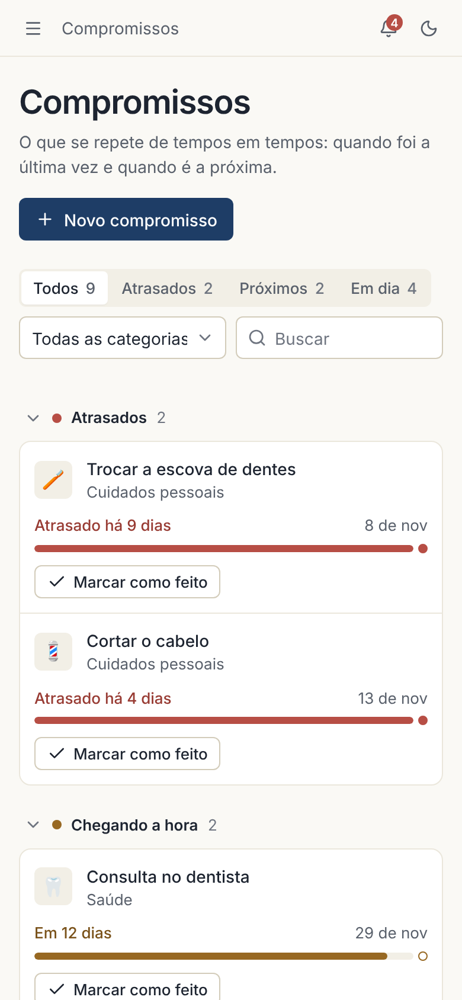

# NishiOS

Sistema pessoal de gestão de vida. Esta é a **fase 1**: o shell do app (barra lateral, topo, tema claro e escuro), o design system e o módulo de **compromissos recorrentes** (corte de cabelo, dentista, exames de rotina...).

Só frontend: sem login e sem backend. Os dados ficam salvos no `localStorage` do navegador e começam com exemplos.


## Como rodar

Precisa do Node 20 ou mais novo.

```bash
git clone https://github.com/joaonishimoto/nishios.git
cd nishios
npm install
npm run dev
```

Abra http://localhost:5173.

Outros comandos: `npm run build` (checa os tipos e gera a versão final em `dist/`) e `npm run typecheck`.

## O que tem na fase 1

- **Início**: o que pede atenção hoje e o que vem depois.
- **Compromissos**: lista agrupada por situação (atrasados, chegando a hora, sem registro, em dia), com filtro por situação e categoria e busca.
  - Cada compromisso tem período (dias, semanas, meses ou anos), última vez feita, próxima data calculada e antecedência do aviso.
  - "Marcar como feito" registra a data no histórico e recalcula a próxima.
  - Painel lateral com o ciclo, as anotações e o histórico. Criar, editar e excluir, com "Desfazer".
- **Avisos**: o sino no topo lista o que está atrasado ou chegando a hora.
- **Design system**: página `/design-system` com todos os tokens e componentes.

## Design system

Cores e fontes são as mesmas do NishiStack: creme quase branco, Azul Nishi (`#1E3D66`), Inter na interface e Space Grotesk só no nome da marca.

Os tokens têm três camadas:

1. **Primitivas** (`--primitive-*`): a paleta crua. Componentes nunca usam direto.
2. **Semânticas** (`--background`, `--primary`, `--danger`...): o papel de cada cor, mais tipografia, espaçamento, raio, sombra, layout e movimento.
3. **Tema Tailwind**: expõe as semânticas como classes (`bg-surface`, `text-muted-foreground`, `rounded-lg`...).

Para mudar o visual do app inteiro, edite só `src/styles/tokens.css`. O modo escuro é o bloco `.dark` no mesmo arquivo.

## Estrutura

```
src/
  styles/
    tokens.css          tokens (primitivas, semânticas, modo escuro)
    index.css           mapeamento para o Tailwind e estilos base
  components/
    ui/                 componentes base: Button, Badge, Field, Dialog, Popover, Segmented, Toast, EmptyState
    shell/              AppShell, Sidebar, Notifications, PageHeader, nav.ts
  modules/
    compromissos/       tudo do módulo: tipos, regras (logic.ts), dados (store.tsx, seed.ts) e telas
  pages/                Início e Design system
```

Cada módulo futuro (tarefas, finanças, pets...) entra como uma pasta em `src/modules/` e uma linha em `src/components/shell/nav.ts`.

Os dados passam todos por `src/modules/compromissos/store.tsx`. Quando chegar a hora do Supabase, é o único arquivo do módulo que precisa mudar.

## Telas

| Início | Painel do compromisso |
| --- | --- |
|  |  |

| Novo compromisso | Modo escuro |
| --- | --- |
|  |  |

| Design system | Celular |
| --- | --- |
|  |  |
