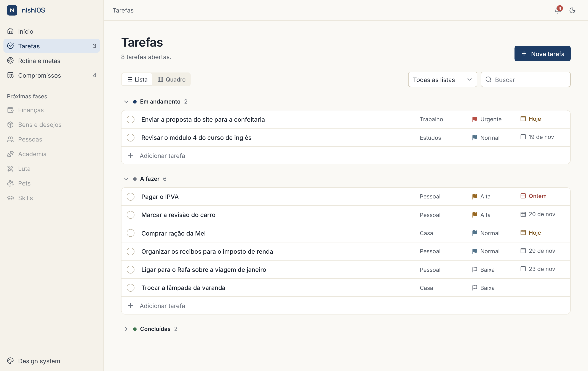
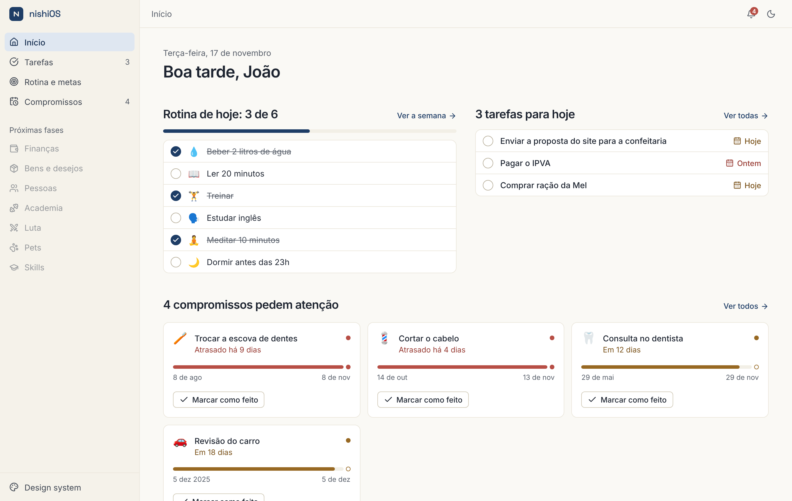
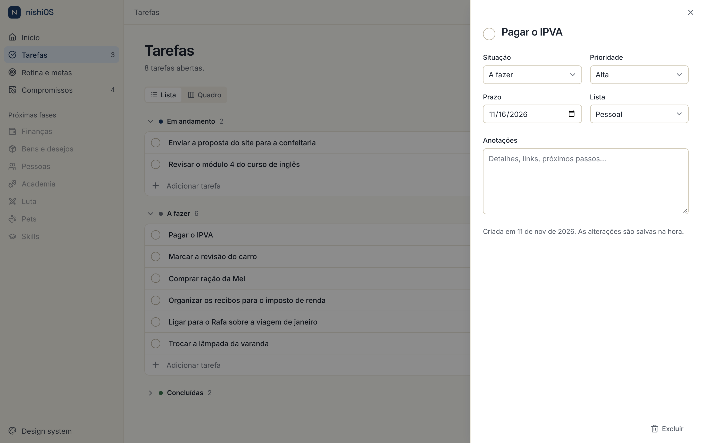
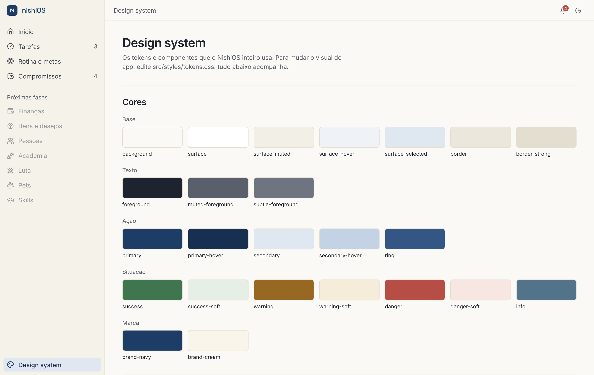
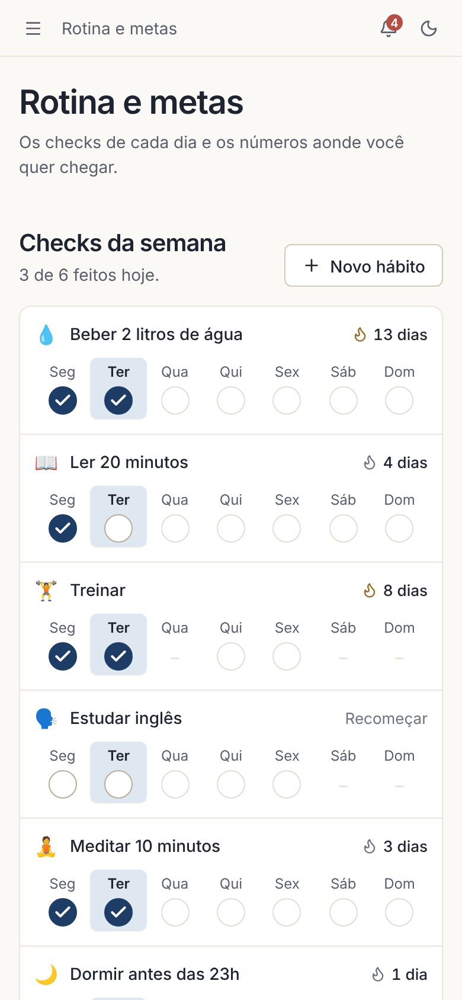

# NishiOS

Sistema pessoal de gestão de vida. Já tem o shell do app (barra lateral, topo, tema claro e escuro), o design system e três módulos: **tarefas**, **rotina e metas** e **compromissos recorrentes**.

Só frontend: sem login e sem backend. Os dados ficam salvos no `localStorage` do navegador e começam com exemplos.



## Como rodar

Precisa do Node 20 ou mais novo.

```bash
git clone https://github.com/joaonishimoto/nishios.git
cd nishios
npm install
npm run dev
```

Abra http://localhost:5173.

Outros comandos: `npm run build` (checa os tipos e gera a versão final em `dist/`) e `npm run typecheck`.

## O que tem

- **Início**: a rotina de hoje, as tarefas que vencem hoje ou estão atrasadas e os compromissos que pedem atenção.
- **Tarefas** (fase 2): visão em lista ou em quadro, com situação (a fazer, em andamento, concluída), prioridade, prazo e lista.
  - "Adicionar tarefa" direto em cada grupo: digite e aperte Enter.
  - No quadro, arraste os cartões entre as colunas.
  - Painel lateral em que cada campo salva na hora. Filtro por lista e busca.
- **Rotina e metas** (fase 2):
  - Checks da semana: cada hábito vale nos dias que você escolher, com a sequência de dias seguidos.
  - Metas com número, unidade, alvo e prazo opcional, e um botão para atualizar o progresso.
- **Compromissos** (fase 1): lista agrupada por situação (atrasados, chegando a hora, sem registro, em dia), com filtro por situação e categoria e busca.
  - Cada compromisso tem período (dias, semanas, meses ou anos), última vez feita, próxima data calculada e antecedência do aviso.
  - "Marcar como feito" registra a data no histórico e recalcula a próxima.
  - Painel lateral com o ciclo, as anotações e o histórico. Criar, editar e excluir, com "Desfazer".
- **Avisos**: o sino no topo lista os compromissos atrasados ou chegando a hora.
- **Design system**: página `/design-system` com todos os tokens e componentes, e o botão para restaurar os dados de exemplo.

## Design system

Cores e fontes são as mesmas do NishiStack: creme quase branco, Azul Nishi (`#1E3D66`), Inter na interface e Space Grotesk só no nome da marca.

Os tokens têm três camadas:

1. **Primitivas** (`--primitive-*`): a paleta crua. Componentes nunca usam direto.
2. **Semânticas** (`--background`, `--primary`, `--danger`...): o papel de cada cor, mais tipografia, espaçamento, raio, sombra, layout e movimento.
3. **Tema Tailwind**: expõe as semânticas como classes (`bg-surface`, `text-muted-foreground`, `rounded-lg`...).

Para mudar o visual do app inteiro, edite só `src/styles/tokens.css`. O modo escuro é o bloco `.dark` no mesmo arquivo.

## Estrutura

```
src/
  styles/
    tokens.css          tokens (primitivas, semânticas, modo escuro)
    index.css           mapeamento para o Tailwind e estilos base
  lib/                  datas, localStorage, tema
  components/
    ui/                 componentes base: Button, Badge, Checkbox, Progress, Field, IconPicker,
                        Dialog, Popover, Segmented, Toast, EmptyState
    shell/              AppShell, Sidebar, Notifications, PageHeader, nav.ts
  modules/
    tarefas/            cada módulo tem seus tipos, regras (logic.ts),
    rotina/             dados (store.tsx, seed.ts) e telas
    compromissos/
  pages/                Início e Design system
```

Cada módulo futuro (finanças, pets...) entra como uma pasta em `src/modules/`, uma rota em `src/App.tsx` e uma linha em `src/components/shell/nav.ts`.

Os dados de cada módulo passam todos pelo seu `store.tsx`, que usa `usePersistentState` (`src/lib/storage.ts`). Quando chegar a hora do Supabase, são esses os arquivos que mudam; as telas continuam iguais.

## Telas

| Início | Tarefas em quadro |
| --- | --- |
|  |  |

| Rotina e metas | Painel da tarefa |
| --- | --- |
|  |  |

| Compromissos | Painel do compromisso |
| --- | --- |
|  |  |

| Modo escuro | Design system |
| --- | --- |
|  |  |

| Tarefas no celular | Rotina no celular |
| --- | --- |
|  |  |
